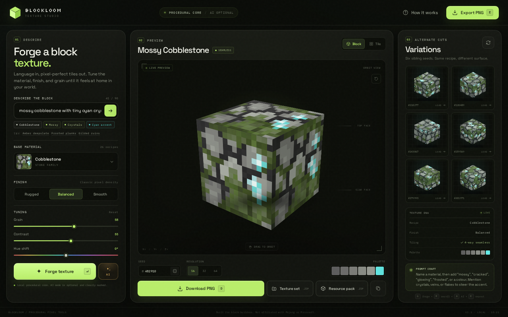
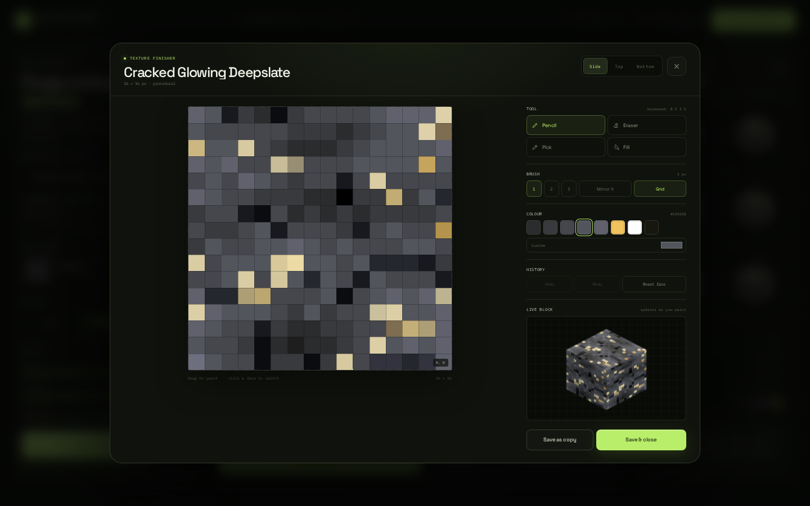
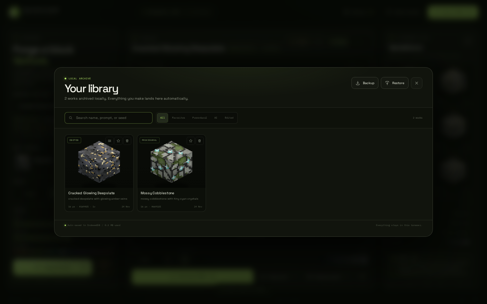
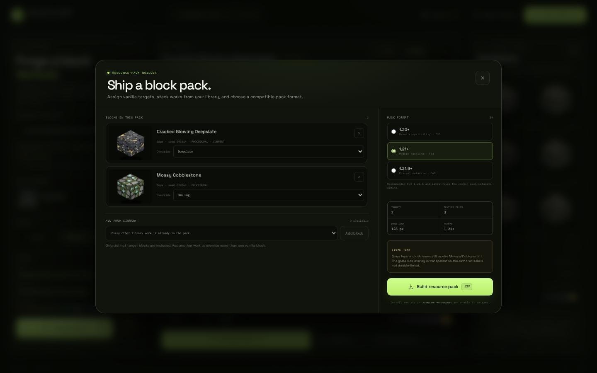
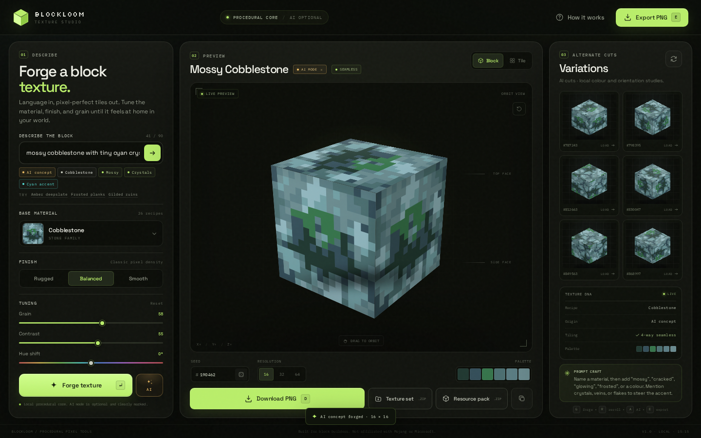

# Blockloom

A local-first **Minecraft texture studio**: prompt-driven generation, a real pixel finisher, and an automatically archived library — plus optional AI concepts and proper resource-pack export.

No account, no build step, no framework. Procedural work runs entirely in the browser.

[](LICENSE) [](https://github.com/MEZTKING/blockloom) [](https://meztking.github.io/blockloom/)



## Run it

```bash
npm run dev
# http://localhost:4173
```

`npm run dev` starts `server.mjs`, a tiny static server that also hosts the optional AI provider proxy.

```bash
npm test     # parser, RGBA, seam, ZIP, target, and format tests
npm run check # tests + syntax checks for every module
```

**Live procedural demo:** [meztking.github.io/blockloom](https://meztking.github.io/blockloom/) — the static Pages build omits the Node server, so AI is disabled there by design. The finisher, local library, and all client-side exports work.

## The loop

**Generate → choose → finish → auto-save → export**

1. Describe a block and forge a tileable texture.
2. Pick one of six sibling seeds, or bring in an AI concept.
3. Open the **Finisher** and paint the last few pixels by hand.
4. Every distinct texture you make is silently archived in **Your Library**.
5. Download a PNG, a texture set, or a drop-in resource pack.

## Texture generation

- 26 hand-built recipes across stone, earth, wood, ore, and nether/end families.
- Natural-language parser: `mossy cobblestone with tiny cyan crystals`, `cracked deepslate with glowing amber veins`, `frosted oak planks`.
- Effects: mossy, cracked, glowing, frosted, ancient, charred, gilded, flecked, wet, flowery, crystals.
- Colour words are context-aware: `cyan crystals` becomes an accent; `blue stone` tints the base.
- Rugged / Balanced / Smooth finish, grain, contrast, and hue controls.
- Draggable CSS 3D block preview and a 2 × 2 tile check.
- Six sibling-seed cuts and exact reproducibility by seed.

## Texture finisher



A real pixel editor for side, top, and bottom faces:

- Pencil, eraser, eyedropper, and flood fill.
- Brush sizes 1 / 2 / 3 px.
- Mirror-X painting and pixel grid.
- Per-face reset.
- Full undo / redo history.
- Live isometric block preview.
- Save & close, or **Save as copy** to branch a new library piece.
- Keyboard: `B` pencil, `E` eraser, `I` eyedropper, `G` fill, `Ctrl/Cmd+Z` undo, `Shift+Ctrl/Cmd+Z` redo.

Edited pixels are palette-scanned, saved back into the originating library work, and immediately used by the 3D preview and every export.

## Local library — everything you make





The library is backed by **IndexedDB** and stores every distinct texture you generate, edit, or import — without a save dialog.

Each archived work keeps:
- side / top / bottom face PNGs,
- all six variation cuts,
- the full recipe (material, seed, finish, grain, contrast, hue, modifiers, accent),
- prompt and palette,
- AI provider, model, influence, and the raw concept image (when applicable),
- an isometric thumbnail and timestamps.

What qualifies as a new work:
- A new forge, material change, resolution change, reroll, seed change, AI concept, or stable control-driven variant produces a new work after the debounce.
- A manual finisher session updates that piece in place. **Save as copy** creates a new piece instead.
- The untouched starting preview is not archived until you interact with it.

The browser is asked for persistent storage. There is no app-level cap; storage is bounded by the browser quota. The library footer shows current usage.

### Backup and restore

- **Backup** downloads a single JSON file containing every work, face, cut, prompt, palette, and AI source.
- **Restore** merges a backup back into the current browser, skipping duplicates by pixel fingerprint.
- The library is per-browser. It does not sync to GitHub, a server, or another device.

## AI concept layer (optional)



- Open **AI** beside Forge.
- The prompt is sent to a configured image provider; the return is:
  1. downscaled to the target resolution,
  2. auto-levelled and blended with the procedural recipe at an adjustable **AI influence**,
  3. snapped to a compact extracted palette,
  4. seam-repaired so the tile wraps,
  5. handed through the same finisher, library, preview, and export pipeline.
- AI results are clearly marked **AI MODE**. Click the badge to return to a procedural render of the same recipe.

**Default provider:** Pollinations (public, no key, free tier of one image every 45 seconds). It is a demo endpoint with no SLA. For production, configure OpenAI Images, Replicate, or a local Automatic1111 server.

### AI provider configuration

```bash
# Free public demo (default)
AI_PROVIDER=pollinations
AI_MODEL=sana

# OpenAI-compatible images endpoint
AI_PROVIDER=openai
AI_API_KEY=sk-...
AI_MODEL=gpt-image-1
AI_BASE_URL=https://api.openai.com/v1   # optional for compatible endpoints

# Replicate
AI_PROVIDER=replicate
AI_API_KEY=r8_...
AI_MODEL=black-forest-labs/flux-schnell

# Local Automatic1111 (no key)
AI_PROVIDER=a1111
AI_BASE_URL=http://127.0.0.1:7860

# Disable the AI layer
AI_ENABLED=false
```

Optional: `AI_IMAGE_SIZE=768`, `AI_TIMEOUT_MS=90000`, `PORT=4173`, `HOST=0.0.0.0`.

`GET /api/ai/status` reports readiness. `POST /api/ai/generate` accepts `{ "prompt": "...", "seed": 1234 }` and returns a base64 image plus provider metadata. Keys live only on the server. Requests are rate-limited, one per client at a time, with the free provider's cooldown surfaced in the UI.

**Privacy:** procedural mode sends nothing anywhere. AI mode sends the concept prompt to the provider shown in the dialog. The returned image and the prompt are stored locally in your library if you keep that work. Use Backup to move the library; nothing is uploaded to GitHub.

## Prompt recipes

```text
[material]                          stone, cobblestone, deepslate, gravel, bricks,
                                    obsidian, dirt, grass, sand, snow, ice, moss,
                                    oak planks, oak log, leaves, netherrack,
                                    end stone, prismarine, terracotta, wool,
                                    gold / diamond / redstone / emerald / copper / lapis ore

[modifier...]                       mossy, cracked, glowing, frosted, ancient,
                                    charred, gilded, flecked, wet, flowery, crystal

[colour]                            cyan, blue, emerald, purple, red, amber, gold,
                                    pink, white, black, teal, silver, ...
```

Examples:

- `mossy cobblestone with tiny cyan crystals`
- `cracked deepslate with glowing amber veins`
- `ancient gilded stone`
- `frosted oak planks`
- `overgrown grass block`
- `charred netherrack with ember flecks`

A colour word near `crystal`, `gem`, `vein`, `fleck`, `glow`, or `ore` becomes an accent instead of recolouring the whole block.

## Exports

### PNG
The current side face at 16 / 32 / 64 px, ready for a resource pack, mod, or image editor.

### Texture set (.zip)
```text
blockloom_<material>_<seed>_<px>px.zip
├── README.txt
├── texture.json
├── side.png / top.png / bottom.png
├── preview.png
├── tile-2x2.png
├── ai-source.(jpg|png)       # AI mode only
├── ai-concept.json           # AI provenance
└── variations/
    └── six alternate cuts
```

### Resource pack (.zip) — interactive builder
Open **Resource pack** in the export row. The builder lets you:

- choose the **vanilla target** for every block (26 targets, including multi-face grass and log mappings),
- add more works from your library to build a **multi-block pack**,
- pick a **pack format profile** — broad 1.20+, modern 1.21+, or current 1.21.9+,
- see target and texture-file counts before exporting.

```text
blockloom_resourcepack_<target>_<seed>_<px>px.zip   # single block
blockloom_resourcepack_<n>blocks_<date>.zip          # multi-block
├── pack.mcmeta
├── pack.png
├── assets/minecraft/textures/block/<vanilla paths>.png
├── README.txt
└── blockloom-pack.json
```

`pack.mcmeta` writes `pack_format`, `supported_formats`, and the newer `min_format` / `max_format` fields so the same texture-only pack can target old and current readers.

Drop the zip into `.minecraft/resourcepacks/`, then enable **Blockloom** in Options → Resource Packs. It overrides existing vanilla block texture paths; it does not create a new block.

- All 26 materials map to a valid vanilla target, and any target can be selected for any texture.
- Grass includes top, side, and a transparent side overlay so the authored side is not double-tinted. The top still inherits Minecraft's biome tint.
- Oak leaves keep vanilla's biome tint, so in-game colour may differ.
- Logs receive side + top textures.
- Duplicate vanilla targets are prevented in the builder; the pack builder also skips duplicates defensively.

## Why the hybrid AI approach

At Minecraft resolution, texture quality comes from **palette discipline, controlled noise, and seamless edges** — not unbounded generation. Raw model output at 16 px tends to flatten into colour blobs. Blockloom treats the AI image as a *concept source*: auto-levels and palette extraction keep its colour identity, while the procedural surface supplies readable cobble, grain, bark, and ore structure. The **AI influence** slider moves between recipe structure and raw concept pixels.

## Project structure

```text
index.html          app shell and UI
styles.css          design system, 3D cube, AI lab, library, finisher, responsive layouts
js/engine.js        noise, material recipes, prompt parser, isometric renderer
js/ai.js            provider request client, recipe blend, palette snap, seam repair, AI cuts
js/finisher.js      pixel editor: tools, history, faces, live preview
js/library.js       IndexedDB work archive, fingerprints, favorites, storage estimate
js/resourcepack.js  vanilla target mapping, format profiles, and multi-block resource-pack ZIP builder
js/app.js           state, interactions, library UI, finisher UI, pack builder, exports
js/zip.js           dependency-free stored ZIP writer
server.mjs          static server + AI provider proxy
assets/fonts/       vendored Space Grotesk, IBM Plex Mono, Silkscreen
screenshots/        preview images
```

## Notes and limits

- The procedural core is not an ML model. The AI layer is optional and clearly labelled.
- The free Pollinations demo can be rate-limited or unavailable (shared public quota). Configure a private provider for serious use.
- The local library is per-browser/device. Clearing site data removes it; use Backup first.
- Backups restore through the library's **Restore** button; duplicates by pixel fingerprint are skipped.
- All PNGs are opaque except intentionally erased pixels and the grass side overlay. Vanilla leaf tinting is preserved.
- Surface textures wrap by construction; AI tiles are edge-repaired, and log tops are concentric rings by design.
- Built and tested in Chromium. Uses native `<dialog>`, the Popover API, `color-mix()`, CSS 3D transforms, Canvas, and IndexedDB.
- Resource packs override existing vanilla blocks. New blocks still require a mod or datapack.
- GitHub Pages runs the procedural client, finisher, library, and exports. AI requires the Node server.

## Taking it further

- A version-history browser inside the library for every finisher save.
- Palette import/export (JASC-PAL / GPL).
- Share links or `.blockloom` project bundles.
- Multi-block resource-pack sessions.
- Pack-format picker (1.20.x → current) and tint-safe grass/leaf model overrides.
- `.mcmeta` support for animated textures.

## Validation

`npm test` runs a dependency-free suite with the Node test runner:

- prompt parsing for materials, tints, accents, and effects,
- all 26 materials across side/top/bottom faces,
- RGBA completeness and deterministic seeds,
- a seam sanity ratio at 16 px,
- all finishes and effect overlays,
- 32 px / 64 px rendering,
- ZIP central-directory and payload integrity,
- resource-pack target mappings and format profiles.

`npm run check` adds syntax checks for every module and package manifest. Browser-level smoke tests have also been run manually in Chromium across desktop, mobile, and GitHub Pages.

## License

MIT. See [LICENSE](LICENSE).

## Credits

Material recipes, prompt grammar, AI post-processing, finisher, library, and exporter are original to this project. Fonts are from Google Fonts under the SIL Open Font License. Blockloom is not affiliated with Mojang or Microsoft.
