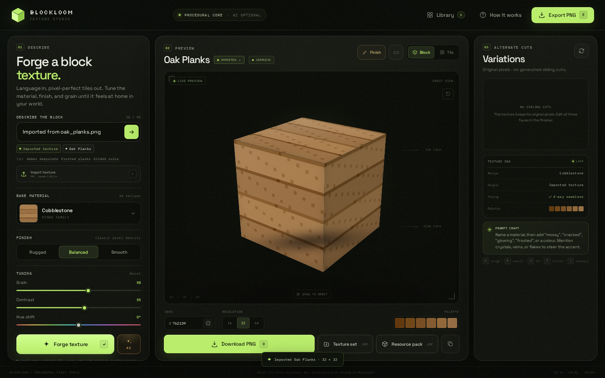
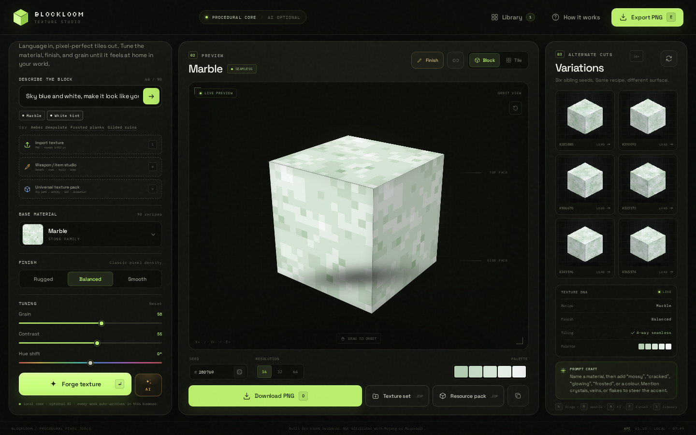
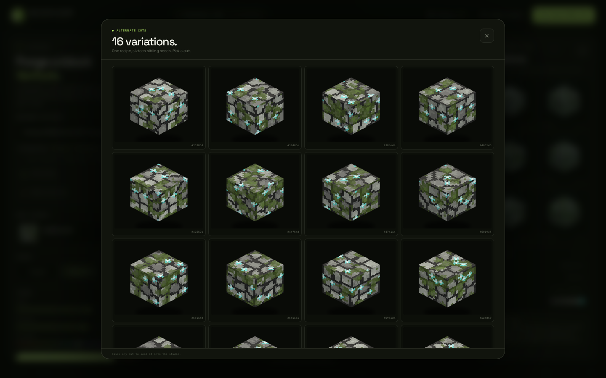
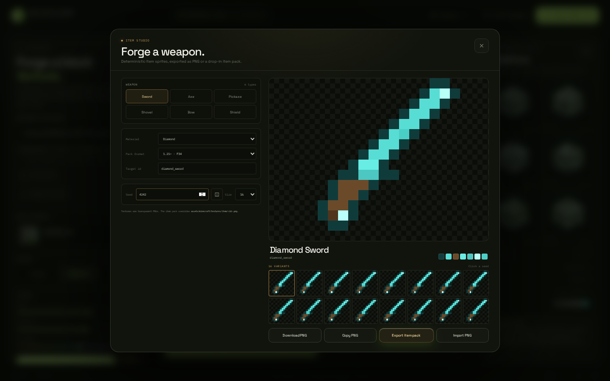
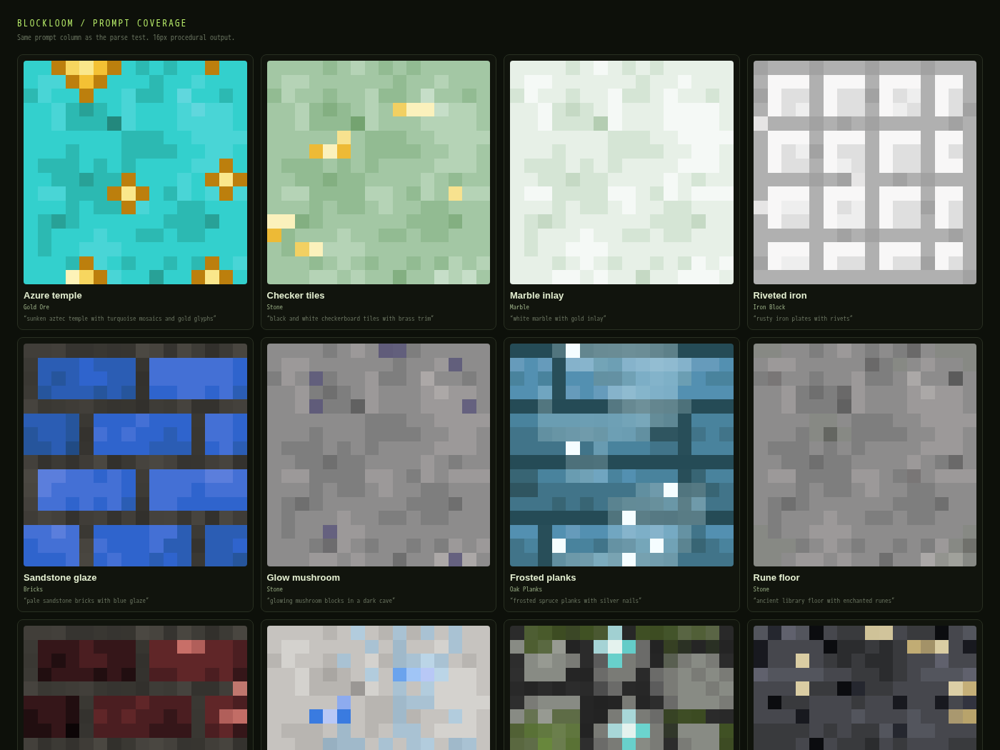
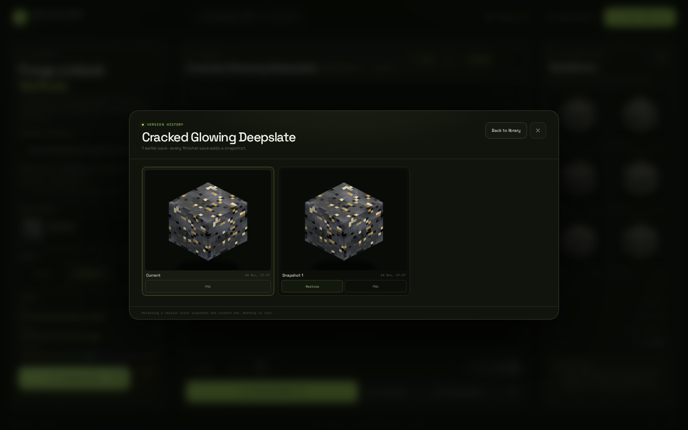
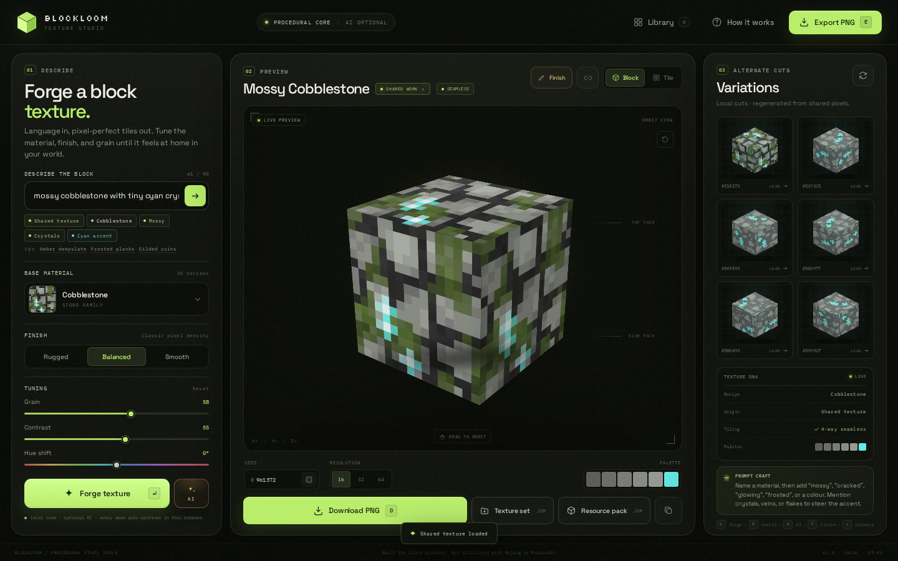
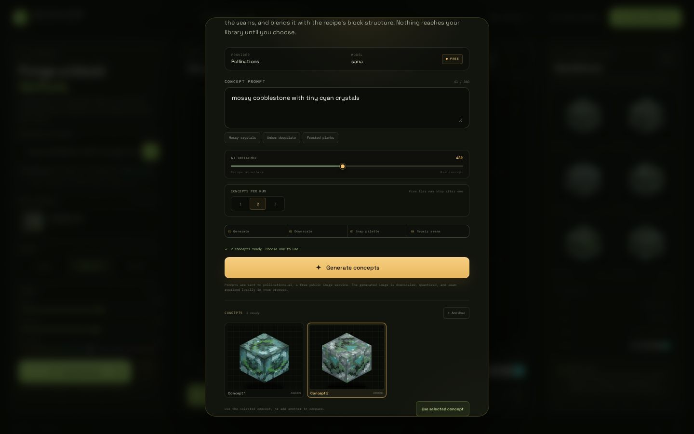

# Blockloom

A local-first, offline-capable **Minecraft texture studio** and **local texture-generation bridge** for other apps: prompt-driven generation, import of existing Minecraft PNGs, a real pixel finisher, an automatically archived and versioned library, shareable links, and proper resource-pack export. AI is optional — every core feature works without it.

No account, no framework. The web app has no build step; the optional Windows shell uses Tauri.

[](LICENSE) [](https://github.com/MEZTKING/blockloom) [](https://meztking.github.io/blockloom/)


## Run it

```bash
npm run dev       # full studio + optional AI proxy at http://127.0.0.1:4173
npm run dev:noai  # the same studio with AI disabled
npm run bridge    # studio + local texture API, AI disabled
npm run check     # tests + syntax checks
```

`npm run dev` starts `server.mjs`, a tiny static server that also hosts the optional AI provider proxy and the local texture bridge. The server binds to `127.0.0.1` by default; set `HOST=0.0.0.0` only with `BRIDGE_TOKEN`.

```bash
npm test     # parser, RGBA, seam, import, ZIP, PWA, share, target, and format tests
npm run check # tests + syntax checks for every module
```

**Live procedural demo:** [meztking.github.io/blockloom](https://meztking.github.io/blockloom/) — the static Pages build omits the Node server, so AI is disabled there by design. The finisher, import, local library, offline cache, and all client-side exports work.

**Core package:** [@blockloom/core v1.3.0](https://github.com/MEZTKING/blockloom/releases/tag/core-v1.3.0) — DOM-free block + item generator, 90 recipes, types, and worker docs.

**Integration handoff:** [issue #1](https://github.com/MEZTKING/blockloom/issues/1) — shared coordination channel for MCSuperMods.

**Local API release:** [Blockloom Local Texture API v1.0.0](https://github.com/MEZTKING/blockloom/releases/tag/api-v1.0.0) — bridge reference, TypeScript client, and batch kit.

**Preview desktop/mobile builds:** [Blockloom v1.10.0](https://github.com/MEZTKING/blockloom/releases/tag/v1.10.0) — unsigned Windows installers and a debug-signed Android APK.

## Windows desktop (Tauri 2)

The web/PWA build remains the canonical app. `src-tauri` wraps the same offline frontend as a Windows desktop application.

### Build on Windows

Prerequisites: **Node 18+**, **Rust stable (MSVC)**, **Visual Studio Build Tools** with the Windows SDK, and WebView2 (bundled or installed by the bootstrapper).

```powershell
npm install
npm run tauri:dev   # development window
npm run tauri:build # MSI + NSIS installers
```

Installers are written to:

```text
src-tauri/target/release/bundle/msi/
src-tauri/target/release/bundle/nsis/
```

The PowerShell helper `scripts/build-windows.ps1` runs checks, builds, and lists the installers.

### Native behavior

- Assets are bundled locally; no Node server and no service worker are needed.
- Exports use a **native Save dialog** through the Rust `save_file` command.
- Import still uses the WebView file picker and drag/drop.
- AI is deliberately **not bundled** in the Windows shell. The Node AI proxy remains a web/dev-server feature.
- Share links point at the public web app, not the local `tauri://` origin.
- The footer **Check updates** button queries GitHub Releases and opens the release page. It is a manual update check; it does not auto-download or install.
- Library data lives in the WebView2 app profile on that machine.

### Code signing

`scripts/sign-windows.ps1` signs the built EXEs, MSI, and NSIS installer with SHA-256 and an RFC3161 timestamp.

```powershell
$env:WINDOWS_CERT_PATH = "C:\path\to\certificate.pfx"
$env:WINDOWS_CERT_PASSWORD = "…"
# or use a certificate already in CurrentUser\My:
$env:WINDOWS_CERT_THUMBPRINT = "…"
.scriptsuild-windows.ps1
```

Without a certificate the build succeeds but installers remain unsigned and trigger Windows SmartScreen.

### Android

GitHub Actions generates the Android project and produces a signed universal APK. The shared Tauri mobile entry point, package identifier, RGBA icons, and mobile capability are in place.

Prerequisites: **JDK 17**, **Android Studio + SDK**, **Android NDK**, Rust Android targets, and the Tauri CLI.

```powershell
npm install
npm run tauri:android:init   # generate src-tauri/gen/android
npm run tauri:android:dev
npm run tauri:android:build  # APK
```

Or run `scripts/build-android.ps1`.

Without `ANDROID_KEYSTORE_BASE64`, CI signs the preview APK with a fresh **debug keystore**. That is installable but not suitable for Play Store distribution or stable updates. Set `ANDROID_KEYSTORE_BASE64`, `ANDROID_KEYSTORE_PASSWORD`, `ANDROID_KEY_ALIAS`, and `ANDROID_KEY_PASSWORD` for a persistent release key.

Android still needs a **Storage Access Framework** save/share adapter for exports; the current native Save dialog is Windows-first. AI remains absent. Full animated-texture and non-square sheet support are still separate work.

### Preview release

GitHub Actions produced [v1.10.0](https://github.com/MEZTKING/blockloom/releases/tag/v1.10.0):

- Windows NSIS and MSI installers (unsigned preview)
- Universal Android APK (debug-signed preview)
- SHA-256 checksums

These are preview artifacts, not store-published or code-signed production releases.

### Release caveats

- Windows installers and the Android APK are built by GitHub Actions in `.github/workflows/`.
- The current Windows installers are **unsigned** until a signing certificate is supplied, so SmartScreen will warn.
- The current Android APK is a **debug-signed preview** unless Android keystore secrets are configured.
- Auto-install updates are not configured. The desktop **Check updates** button only opens the release page.
- Android SAF export, Play Store AAB/signing, and store listing are not complete.

## Local API bridge

The Node server exposes an AI-free texture API at `http://127.0.0.1:4173/api`:

- `GET /api/generate?prompt=...&seed=...&size=16` → PNG (side face)
- `format=json` → metadata + base64 data URLs for side/top/bottom
- `format=zip` → a complete texture set ZIP
- `POST /api/generate` → explicit prompt/material/seed/modifiers/accent recipe
- `POST /api/batch` → up to 64 named texture sets in one ZIP
- `GET /api/materials`, `/api/health`, `/api/openapi.json`

Authentication is optional on loopback. Set `BRIDGE_TOKEN` for a token-protected local/LAN bridge; send `Authorization: Bearer <token>` or `X-Blockloom-Token`. CORS is restricted to local origins by default and configurable with `BRIDGE_ALLOWED_ORIGINS`.

```bash
npm run bridge
curl "http://127.0.0.1:4173/api/generate?prompt=mossy%20cobblestone&seed=42&size=16" -o cobblestone.png
node bin/blockloom.mjs set --prompt "frosted oak planks" --size 32 --out set.zip
```

Full reference: [docs/API.md](docs/API.md). TypeScript client for MCSuperMods/Electron: [examples/mcsupermods-client.ts](examples/mcsupermods-client.ts). Batch example: [examples/batch.json](examples/batch.json).

## Keyboard

| Shortcut | Action |
| --- | --- |
| `Ctrl/Cmd + Enter` | Forge the current prompt |
| `Ctrl/Cmd + K` | Open the library and focus search |
| `G` | New seed |
| `R` | Re-roll |
| `F` | Finisher |
| `L` | Library |
| `A` | AI lab |
| `P` | Resource-pack builder |
| `S` | Copy share link |
| `I` | Import PNG |
| `E` | Download PNG |
| `?` | Open this guide |

Single-letter shortcuts are ignored while typing in a field. Dialogs use labelled native modals, visible focus rings, and reduced-motion support.

## The loop

**Generate → choose → finish → auto-save → export**

1. Describe a block and forge a tileable texture — or import an existing Minecraft PNG.
2. Pick one of six sibling seeds, or bring in an AI concept.
3. Open the **Finisher** and paint the last few pixels by hand.
4. Every distinct texture you make is silently archived in **Your Library**, with version snapshots.
5. Share it as a link, or download a PNG, a texture set, or a drop-in resource pack.

## Import existing textures

Use **Import texture** in the left panel, press **I**, or drop a PNG onto the studio.

- Square block/item textures from **1 to 512 px** keep their pixel dimensions.
- Larger square images are nearest-neighbour scaled to 512 px.
- Vertical animation strips import **frame 1** of the strip; the frame count is shown in the finisher meta. Full animation re-export is not implemented yet.
- Non-square sheets (armor layers, GUI sheets) are rejected with a clear explanation.
- The imported texture becomes side/top/bottom, opens directly in the finisher, is archived as **IMPORTED**, and can be edited, versioned, shared, and packed like any other work.
- No AI or network is involved.



## Item / weapon studio

Open **Weapon / item studio** in the left panel or press **W**.

- Six item types: sword, axe, pickaxe, shovel, bow, shield.
- **16 seed variants** per type/material, click to compare and select.
- Eight material palettes: wood, stone, iron, gold, diamond, netherite, copper, emerald.
- Deterministic 16 px sprites, scalable to 32/64 px, with transparent backgrounds.
- Download PNG, copy PNG, or export a drop-in **item resource pack**.
- **Import PNG** loads an existing item sprite (including one downloaded from a web generator); edit the target id and package it.
- Item pack path: `assets/minecraft/textures/item/<item>.png`.
- Vanilla IDs are used for the five vanilla tool tiers; copper/emerald produce modded IDs.







This is separate from the block library/finisher for now: item sprites export directly rather than entering the three-face block archive. Web-generated textures work through the same local import path; Blockloom does not scrape or log into external services.

Both 16-variant sheets are modeled on the workflow observed in Bloxal’s public studio: one prompt produces a sheet of alternatives, then the creator picks one and edits it.

## Prompt coverage



Material + modifier prompts are strong. Architectural motifs, secondary accents, and plant/entity prompts are the current weak spots. See `screenshots/blockloom-prompt-suite.png`.

## Universal texture packer

Open **Universal texture pack** in the left panel or press **U**.

- Add any PNG or `.png.mcmeta` file.
- Auto-paths under `assets/<namespace>/textures/<folder>/`.
- Edit each full path independently.
- Preserve non-square sheets and animation metadata byte-for-byte.
- Choose pack format; export with `pack.mcmeta`, `pack.png`, README, and a JSON manifest.

This is the packaging path for textures from Bloxal, other generators, or manual pixel art. It is texture-only: it does not add models, item definitions, blockstates, sounds, language files, or new blocks/items.

## Texture generation

- 90 data-driven recipes across stone, earth, wood, glass, wool, concrete, metal, ore, and nether/end families.
- A **Celestial prompt theme** for heaven/sky-city prompts, resolving to pale Marble with blue veining.
- Natural-language parser: `mossy cobblestone with tiny cyan crystals`, `cracked deepslate with glowing amber veins`, `frosted oak planks`.
- Effects: mossy, cracked, glowing, frosted, ancient, charred, gilded, flecked, wet, flowery, crystals.
- Colour words are context-aware: `cyan crystals` becomes an accent; `blue stone` tints the base.
- Rugged / Balanced / Smooth finish, grain, contrast, and hue controls.
- Draggable CSS 3D block preview and a 2 × 2 tile check.
- Six sibling-seed cuts, a 16-variant block contact sheet, and exact reproducibility by seed.
- A shareable compressed link carrying the current pixels and recipe.
- An offline app shell; after first load, generation, import, finishing, library, versions, sharing, and packs work with no network.
- **Import any square block/item texture** from 1–512 px, or the first frame of a vertical animation strip.
- A local HTTP API and CLI for generating block PNGs, full texture sets, and weapon/item sprites for MCSuperMods and other applications.
- A **Weapon / item studio** for swords, axes, pickaxes, shovels, bows, and shields, with PNG and item-pack export.
- A **Universal texture packer** for any PNG path under `assets/<namespace>/textures/`, including entity, armor, GUI, particle, painting, non-square sheets, and `.png.mcmeta` animation metadata.

## Texture finisher


A real pixel editor for side, top, and bottom faces:

- Pencil, eraser, eyedropper, and flood fill.
- Brush sizes 1 / 2 / 3 px.
- Mirror-X painting and pixel grid.
- Per-face reset.
- Full undo / redo history.
- Live isometric block preview.
- Save & close, or **Save as copy** to branch a new library piece.
- Keyboard: `B` pencil, `E` eraser, `I` eyedropper, `G` fill, `Ctrl/Cmd+Z` undo, `Shift+Ctrl/Cmd+Z` redo.

Edited pixels are palette-scanned, saved back into the originating library work, and immediately used by the 3D preview and every export.

## Local library — everything you make





The library is backed by **IndexedDB** and stores every distinct texture you generate, edit, or import — without a save dialog.

Each archived work keeps:
- side / top / bottom face PNGs,
- all six variation cuts,
- the full recipe (material, seed, finish, grain, contrast, hue, modifiers, accent),
- prompt and palette,
- AI provider, model, influence, and the raw concept image (when applicable),
- an isometric thumbnail and timestamps.

What qualifies as a new work:
- A new forge, material change, resolution change, reroll, seed change, AI concept, or stable control-driven variant produces a new work after the debounce.
- A manual finisher session updates that piece in place. **Save as copy** creates a new piece instead.
- The untouched starting preview is not archived until you interact with it.

The browser is asked for persistent storage. There is no app-level cap; storage is bounded by the browser quota. The library footer shows current usage.

### Version history

Every **Save & close** in the finisher snapshots the previous pixels before overwriting them. The library card grows a history button and a version count.

- Open history to see **Current** plus earlier snapshots.
- **Restore** first snapshots the current state, then applies the older one — nothing is lost.
- Every snapshot can be downloaded as a PNG.
- Up to 30 snapshots are kept per work. Versions travel with the library backup.
- **Save as copy** starts a new work with a fresh history.

### Backup and restore

- **Backup** downloads a single JSON file containing every work, face, cut, prompt, palette, and AI source.
- **Restore** merges a backup back into the current browser, skipping duplicates by pixel fingerprint.
- The library is per-browser. It does not sync to GitHub, a server, or another device.

## Share links

The share icon beside Finish copies a URL that carries the current texture in its **fragment**, compressed with gzip and base64url.

- No server call and no upload; the fragment never reaches GitHub.
- Includes the current side/top/bottom pixels, palette, material, seed, prompt, and settings.
- Variations are regenerated locally as six cuts from the shared pixels.
- AI provenance and raw AI source images are **not** included; a received link opens as a **SHARED WORK** snapshot.
- The recipient gets the exact pixels, can finish them, and can export.
- Links are size-bounded. A tested 64 px texture fits in roughly 27 KB; over-limit links tell you to export a texture set instead.



## Offline and AI-free use

Blockloom does not need a server, network, or AI provider for its core loop.

- After one online load, a service worker caches the complete app shell.
- The footer switches to **OFFLINE** when the browser loses network access.
- Generation, the finisher, library search, version restore, share-link creation, and pack export all keep working offline.
- AI/API requests are never cached and are skipped entirely in procedural-only mode.
- **AI is optional**: leave it unconfigured, run `npm run dev:noai`, pass `?noai`, or use the static Pages build.
- On supporting browsers, the app is installable as a home-screen/standalone app.


The cache version lives in `sw.js` and is checked against `package.json` by the test suite. Bump both together when deploying.

## AI concept layer (optional)



- Open **AI** beside Forge.
- Choose **1–3 concepts per run**. Each prompt is sent to the configured image provider; every return is:
  1. downscaled to the target resolution,
  2. auto-levelled and blended with the procedural recipe at an adjustable **AI influence**,
  3. snapped to a compact extracted palette,
  4. seam-repaired so the tile wraps,
  5. shown in a candidate sheet with the other concepts.
- Compare the candidates, select one, and choose **Use selected concept**. Only then does it enter the studio and auto-archive. Discarded candidates are never saved.
- **+ Another** adds one more provider concept to the sheet for comparison (up to four at a time).
- AI results are clearly marked **AI MODE**. Click the badge to return to a procedural render of the same recipe.

**Default provider:** Pollinations (public, no key, free tier of one image every 45 seconds). It is a demo endpoint with no SLA. A multi-concept run may therefore stop after the first candidate; **+ Another** lets you add another after the cooldown. For production, configure OpenAI Images, Replicate, or a local Automatic1111 server.

### AI provider configuration

```bash
# Free public demo (default)
AI_PROVIDER=pollinations
AI_MODEL=sana

# OpenAI-compatible images endpoint
AI_PROVIDER=openai
AI_API_KEY=sk-...
AI_MODEL=gpt-image-1
AI_BASE_URL=https://api.openai.com/v1   # optional for compatible endpoints

# Replicate
AI_PROVIDER=replicate
AI_API_KEY=r8_...
AI_MODEL=black-forest-labs/flux-schnell

# Local Automatic1111 (no key)
AI_PROVIDER=a1111
AI_BASE_URL=http://127.0.0.1:7860

# Disable the AI layer
AI_ENABLED=false
```

Optional: `AI_IMAGE_SIZE=768`, `AI_TIMEOUT_MS=90000`, `PORT=4173`, `HOST=0.0.0.0`.

`GET /api/ai/status` reports readiness. `POST /api/ai/generate` accepts `{ "prompt": "...", "seed": 1234 }` and returns a base64 image plus provider metadata. Keys live only on the server. Requests are rate-limited, one per client at a time, with the free provider's cooldown surfaced in the UI.

**Privacy:** procedural mode sends nothing anywhere. AI mode sends the concept prompt to the provider shown in the dialog. The returned image and the prompt are stored locally in your library if you keep that work. Use Backup to move the library; nothing is uploaded to GitHub.

## Prompt recipes

```text
[material]                          stone, cobblestone, deepslate, gravel, bricks,
                                    obsidian, dirt, grass, sand, snow, ice, moss,
                                    oak planks, oak log, leaves, netherrack,
                                    end stone, prismarine, terracotta, wool,
                                    gold / diamond / redstone / emerald / copper / lapis ore

[modifier...]                       mossy, cracked, glowing, frosted, ancient,
                                    charred, gilded, flecked, wet, flowery, crystal

[colour]                            cyan, blue, emerald, purple, red, amber, gold,
                                    pink, white, black, teal, silver, ...
```

Examples:

- `mossy cobblestone with tiny cyan crystals`
- `cracked deepslate with glowing amber veins`
- `ancient gilded stone`
- `frosted oak planks`
- `overgrown grass block`
- `charred netherrack with ember flecks`

A colour word near `crystal`, `gem`, `vein`, `fleck`, `glow`, or `ore` becomes an accent instead of recolouring the whole block.

## Exports

### PNG
The current side face at 16 / 32 / 64 px, ready for a resource pack, mod, or image editor.

### Texture set (.zip)
```text
blockloom_<material>_<seed>_<px>px.zip
├── README.txt
├── texture.json
├── side.png / top.png / bottom.png
├── preview.png
├── tile-2x2.png
├── ai-source.(jpg|png)       # AI mode only
├── ai-concept.json           # AI provenance
└── variations/
    └── six alternate cuts
```

### Resource pack (.zip) — interactive builder
Open **Resource pack** in the export row. The builder lets you:

- choose the **vanilla target** for every block (89 targets, including multi-face grass and log mappings),
- add more works from your library to build a **multi-block pack**,
- pick a **pack format profile** — broad 1.20+, modern 1.21+, or current 1.21.9+,
- reorder entries with the arrow controls — the first entry supplies the pack icon,
- see target and texture-file counts before exporting,
- optionally **untint the grass top** through a 1.21+ model override. The toggle is disabled on the 1.20+ profile; oak leaves keep vanilla biome tint.

```text
blockloom_resourcepack_<target>_<seed>_<px>px.zip   # single block
blockloom_resourcepack_<n>blocks_<date>.zip          # multi-block
├── pack.mcmeta
├── pack.png
├── assets/minecraft/textures/block/<vanilla paths>.png
├── README.txt
└── blockloom-pack.json
```

`pack.mcmeta` writes `pack_format`, `supported_formats`, and the newer `min_format` / `max_format` fields so the same texture-only pack can target old and current readers.

Drop the zip into `.minecraft/resourcepacks/`, then enable **Blockloom** in Options → Resource Packs. It overrides existing vanilla block texture paths; it does not create a new block.

- All 90 recipes map to their actual vanilla texture paths; the builder exposes 89 target descriptors grouped by family.
- Grass includes top, side, and a transparent side overlay so the authored side is not double-tinted. With a 1.21+/1.21.9+ profile, **Untint grass top** adds an official-style grass model with `tintindex` removed.
- Oak leaves always keep vanilla's biome tint, so in-game colour may differ.
- Logs receive side + top textures.
- Duplicate vanilla targets are prevented in the builder; the pack builder also skips duplicates defensively.

## Why the hybrid AI approach

At Minecraft resolution, texture quality comes from **palette discipline, controlled noise, and seamless edges** — not unbounded generation. Raw model output at 16 px tends to flatten into colour blobs. Blockloom treats the AI image as a *concept source*: auto-levels and palette extraction keep its colour identity, while the procedural surface supplies readable cobble, grain, bark, and ore structure. The **AI influence** slider moves between recipe structure and raw concept pixels.

## Project structure

```text
index.html          app shell and UI
styles.css          design system, 3D cube, AI lab, library, finisher, responsive layouts
js/importer.js     square/animation import planning and filename titles
core/items.js      deterministic weapon/item sprite templates and generator
js/itempack.js     item/weapon resource-pack export
server/bridge.mjs   local AI-free block + item generator, API model, batch/ZIP logic
server/png.mjs      dependency-free RGBA PNG encoder
bin/blockloom.mjs   CLI for PNG, texture-set ZIP, batch, materials
docs/API.md         HTTP bridge and MCSuperMods integration reference
examples/           TypeScript client and batch JSON
core/              @blockloom/core: DOM-free generator, data recipes, prompt parser, types
js/engine.js        browser canvas wrapper around @blockloom/core
src-tauri/          Tauri 2 Windows shell, Rust save command, capabilities, icons
scripts/prepare-tauri.mjs  stages the static app into dist/
scripts/build-windows.ps1  Windows installer helper
scripts/sign-windows.ps1   SHA-256 code-signing helper
scripts/build-android.ps1  Android APK helper
scripts/install-workflows.ps1  restores ci/ templates after workflow scope changes
ci/                copies of the active Windows and Android CI templates
js/ai.js            provider request client, recipe blend, palette snap, seam repair, AI cuts
js/finisher.js      pixel editor: tools, history, faces, live preview
js/library.js       IndexedDB work archive, versions, fingerprints, favorites, storage estimate
js/resourcepack.js  vanilla target mapping, format profiles, and multi-block resource-pack ZIP builder
js/share.js         gzip/base64url share links and URL-fragment decoding
js/update.js        manual GitHub release version comparison
js/version.js       app version constant
sw.js              offline app-shell worker
manifest.webmanifest  installable PWA metadata
js/app.js           state, interactions, library/version/share UI, finisher, pack builder, exports
js/zip.js           dependency-free stored ZIP writer
server.mjs          static server + AI provider proxy
assets/fonts/       vendored Space Grotesk, IBM Plex Mono, Silkscreen
screenshots/        preview images
```

## Notes and limits

- Item sprites are export-only for now; they do not enter the block library, finisher, or block pack builder.
- Item packs override item texture paths only; they do not add new items or item models.
- The universal packer can package any texture path, but Blockloom still only generates blocks and a limited set of items/weapons procedurally.

- The local bridge is procedural only; it never calls an AI provider.
- The Tauri Windows/Android apps do **not** start the HTTP bridge. Run `npm run bridge` separately for MCSuperMods or other apps.

- The procedural core is not an ML model. The AI layer is optional and clearly labelled.
- The free Pollinations demo can be rate-limited or unavailable (shared public quota). Configure a private provider for serious use.
- The local library is per-browser/device. Clearing site data removes it; use Backup first.
- Backups restore through the library's **Restore** button; duplicates by pixel fingerprint are skipped.
- AI candidate comparison is in-memory only; only the chosen concept becomes a work and is archived.
- All PNGs are opaque except intentionally erased pixels and the grass side overlay. Vanilla leaf tinting is preserved.
- Surface textures wrap by construction; AI tiles are edge-repaired, and log tops are concentric rings by design.
- Built and tested in Chromium. Uses native `<dialog>`, the Popover API, `color-mix()`, CSS 3D transforms, Canvas, and IndexedDB.
- Resource packs override existing vanilla blocks. New blocks still require a mod or datapack.
- GitHub Pages runs the procedural client, finisher, library, and exports. AI requires the Node server.

## Taking it further

- Palette import/export (JASC-PAL / GPL).
- Full `.blockloom` project bundles with AI source provenance.
- Multi-block resource-pack sessions.
- Pack-format picker (1.20.x → current) and tint-safe grass/leaf model overrides.
- `.mcmeta` support for animated textures.

## Validation

`npm test` runs a dependency-free suite with the Node test runner:

- prompt parsing for materials, tints, accents, and effects,
- all 90 block materials across side/top/bottom faces,
- deterministic item/weapon sprites, item golden hashes, and target IDs,
- item PNG and item-pack export paths,
- RGBA completeness and deterministic seeds,
- a seam sanity ratio at 16 px,
- all finishes and effect overlays,
- 32 px / 64 px rendering,
- ZIP central-directory and payload integrity,
- resource-pack target mappings and format profiles,
- compressed share-link round-trips, fragment URLs, oversize rejection, and version checks,
- PNG encoding, deterministic bridge output, batch ZIP manifests, API auth, CORS, and live bridge endpoints,
- square/animated/large import planning and filename titles,
- installable manifest metadata and complete offline app-shell cache coverage,
- Tauri configuration, icon inventory, native save bridge, desktop-mode behavior, update-check version logic, and active CI workflows.

`npm run check` adds syntax checks for every module and package manifest. Browser-level smoke tests have also been run manually in Chromium across desktop, mobile, and GitHub Pages, including keyboard shortcuts, pack reorder, version restore, and share-link handoff.

## License

MIT. See [LICENSE](LICENSE).

## Credits

Material recipes, prompt grammar, AI post-processing, finisher, library, and exporter are original to this project. Fonts are from Google Fonts under the SIL Open Font License. Blockloom is not affiliated with Mojang or Microsoft.
