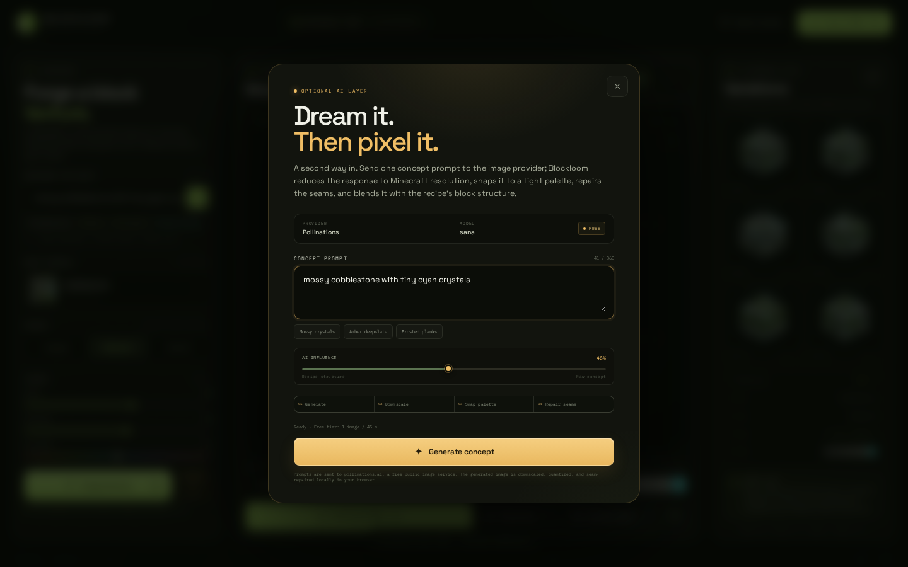

# Blockloom

[](LICENSE) [](https://github.com/MEZTKING/blockloom) [](https://meztking.github.io/blockloom/)

A local, prompt-driven **Minecraft texture studio** — a Bloxal-like flow with a procedural core, an optional real AI concept layer, and a proper resource-pack export.

Describe a block, choose a material, tune the finish, and get a tileable 16 × 16 / 32 × 32 / 64 × 64 texture, a 3D block preview, and files you can actually install in Minecraft.


## Run it

```bash
npm run dev
# http://localhost:4173
```

No dependencies, no build step. `npm run dev` starts `server.mjs`, a small static file server that also hosts the optional AI endpoint.

**Live procedural demo:** [meztking.github.io/blockloom](https://meztking.github.io/blockloom/) — the static Pages build omits the Node server, so AI is disabled there by design. Everything else runs locally in the browser.

## Live demo

The GitHub Pages build runs the procedural studio and all client-side exports. Because Pages cannot host `server.mjs`, the AI dialog explicitly reports that it is a static demo and asks you to run the Node server locally.

## Two ways to make a texture

### 1. Procedural — instant, local, deterministic
- 26 hand-built recipes across stone, earth, wood, ore, and nether/end families.
- Natural-language parser: `mossy cobblestone with tiny cyan crystals`, `cracked deepslate with glowing amber veins`, `frosted oak planks`.
- Effects: mossy, cracked, glowing, frosted, ancient, charred, gilded, flecked, wet, flowery, crystals.
- Colour words are context-aware: `cyan crystals` becomes an accent; `blue stone` tints the base.
- Rugged / Balanced / Smooth finish, grain, contrast, and hue controls.
- Draggable CSS 3D block preview and a 2 × 2 tile check.
- Six sibling-seed variations and exact reproducibility by seed.

### 2. AI concept — optional, real provider call
- Open **AI** beside the Forge button.
- The prompt is sent to a configured image provider; the returned concept is:
  1. downscaled to the target Minecraft resolution,
  2. blended with the procedural recipe at an adjustable **AI influence**,
  3. snapped to an extracted compact palette,
  4. seam-repaired so the tile wraps,
  5. handed back to the same preview and export pipeline.
- The result is clearly marked **AI MODE** in the studio. Click the badge to return to the procedural recipe.
- AI output is a concept source, not a shortcut around the pixel, palette, and tiling rules.

**Default provider:** Pollinations (public, no key needed, free tier of one image every 45 seconds). It is a demo/public endpoint with no SLA. For production, configure OpenAI Images, Replicate, or a local Automatic1111 server.




## AI provider configuration

Environment variables are read by `server.mjs`. Keys stay on the server; they are never sent to the browser.

```bash
# Free public demo (default)
AI_PROVIDER=pollinations
AI_MODEL=sana

# OpenAI-compatible images endpoint
AI_PROVIDER=openai
AI_API_KEY=sk-...
AI_MODEL=gpt-image-1
AI_BASE_URL=https://api.openai.com/v1   # optional for compatible endpoints

# Replicate
AI_PROVIDER=replicate
AI_API_KEY=r8_...
AI_MODEL=black-forest-labs/flux-schnell

# Local Automatic1111 (no key)
AI_PROVIDER=a1111
AI_BASE_URL=http://127.0.0.1:7860

# Disable the AI layer entirely
AI_ENABLED=false
```

Optional:

```bash
AI_IMAGE_SIZE=768       # requested provider resolution
AI_TIMEOUT_MS=90000
PORT=4173
HOST=0.0.0.0
```

`GET /api/ai/status` reports the provider and readiness. `POST /api/ai/generate` accepts `{ "prompt": "...", "seed": 1234 }` and returns a base64 image plus provider metadata. Requests are rate-limited and one generation per client runs at a time. The default provider also enforces its public 45-second free-tier cooldown.

**Privacy:** procedural mode sends nothing anywhere. AI mode sends the concept prompt to the provider shown in the dialog. The returned image is processed in the browser. The optional texture-set export includes the raw concept image and provenance JSON; the resource-pack export does not.

## Prompt recipes

```text
[material]                          stone, cobblestone, deepslate, gravel, bricks,
                                    obsidian, dirt, grass, sand, snow, ice, moss,
                                    oak planks, oak log, leaves, netherrack,
                                    end stone, prismarine, terracotta, wool,
                                    gold / diamond / redstone / emerald / copper / lapis ore

[modifier...]                       mossy, cracked, glowing, frosted, ancient,
                                    charred, gilded, flecked, wet, flowery, crystal

[colour]                            cyan, blue, emerald, purple, red, amber, gold,
                                    pink, white, black, teal, silver, ...
```

Examples:

- `mossy cobblestone with tiny cyan crystals`
- `cracked deepslate with glowing amber veins`
- `ancient gilded stone`
- `frosted oak planks`
- `overgrown grass block`
- `charred netherrack with ember flecks`

A colour word near `crystal`, `gem`, `vein`, `fleck`, `glow`, or `ore` becomes an accent instead of recolouring the whole block.

## Exports

### PNG
The side texture at the selected 16 / 32 / 64 px resolution, ready for a resource pack, mod, or image editor.

### Texture set (.zip)
```text
blockloom_<material>_<seed>_<px>px.zip
├── README.txt
├── texture.json
├── side.png / top.png / bottom.png
├── preview.png
├── tile-2x2.png
├── ai-source.(jpg|png)      # AI mode only
├── ai-concept.json           # AI provenance
└── variations/
    └── six alternate cuts
```

### Resource pack (.zip) — installable
A proper texture override pack for one vanilla block target:

```text
blockloom_resourcepack_<target>_<seed>_<px>px.zip
├── pack.mcmeta
├── pack.png
├── assets/minecraft/textures/block/<vanilla paths>.png
├── README.txt
└── blockloom-pack.json
```

Install by dropping the zip into `.minecraft/resourcepacks/`, then enabling **Blockloom** in Options → Resource Packs. It overrides the vanilla block's textures by path; it does not create a new block.

- Pack format **34** (Minecraft 1.21+; `supported_formats` set to 34–99).
- Grass blocks include top, side, and a transparent side overlay so the authored side is not double-tinted. The top still inherits Minecraft's biome tint.
- Oak leaves keep vanilla's biome tint, so in-game colour may differ.
- Logs receive side + top textures.
- All 26 materials map to a valid vanilla target.

## Why the hybrid AI approach

At Minecraft resolution, texture quality comes from **palette discipline, controlled noise, and seamless edges** — not from unbounded generation. Raw model output at 16 px tends to flatten into colour blobs. Blockloom therefore treats the AI image as a *concept source*: auto-levels and palette extraction keep its colour identity, while the procedural surface supplies readable cobble, grain, bark, and ore structure. The **AI influence** slider moves between recipe structure and raw concept pixels.

The result is instant, reproducible by seed, offline by default, and exportable. The same pipeline can accept a better image model without changing the exporter, preview, or pack builder.

## Project structure

```text
index.html          app shell and UI
styles.css          design system, 3D cube, AI lab, responsive layouts
js/engine.js        noise, material recipes, prompt parser, isometric renderer
js/ai.js            provider client, recipe blend, palette snap, seam repair, AI cuts
js/resourcepack.js  vanilla target mapping and resource-pack ZIP builder
js/app.js           state, interactions, exports
js/zip.js           dependency-free stored ZIP writer
server.mjs          static server + AI provider proxy
assets/fonts/       vendored Space Grotesk, IBM Plex Mono, Silkscreen
screenshots/        preview images
```

## Notes and limits

- The procedural core is not an ML model. The AI layer is optional and clearly labelled.
- The free Pollinations demo can be rate-limited or unavailable; configure a private provider for serious use.
- All PNGs have an opaque alpha channel except the intentional grass side overlay; vanilla leaves tinting is preserved.
- Surface textures wrap by construction; AI tiles are edge-repaired, and log tops are concentric rings by design.
- Built and tested in Chromium. Uses native `<dialog>`, the Popover API, `color-mix()`, CSS 3D transforms, and Canvas.
- Maps generated textures onto existing vanilla block texture paths. New blocks still require a mod or datapack.

## Taking it further

- Pixel brush / touch-up editor.
- Import/export JASC-PAL or GPL palettes.
- Shareable seed + recipe links.
- Multiple AI concepts composited or inpainted into one tile.
- `.mcmeta` support for animated textures.
- A proper pack-format picker (1.20.x → current) and model overrides for tint-free grass/leaves.

## License

MIT. See [LICENSE](LICENSE).

## Credits

Material recipes, prompt grammar, AI post-processing, and the exporter are original to this project. Fonts are from Google Fonts under the SIL Open Font License. Blockloom is not affiliated with Mojang or Microsoft.
